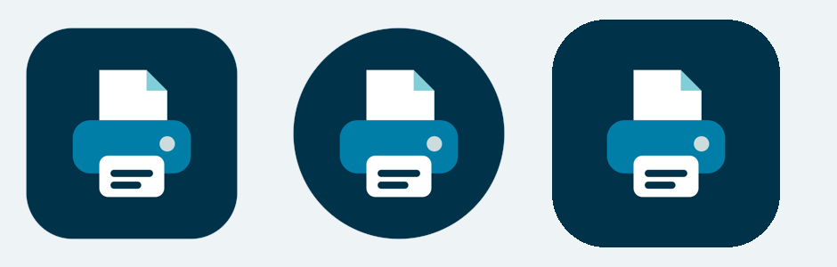
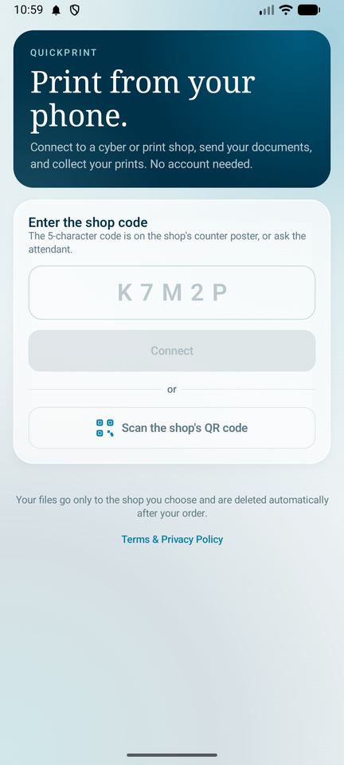
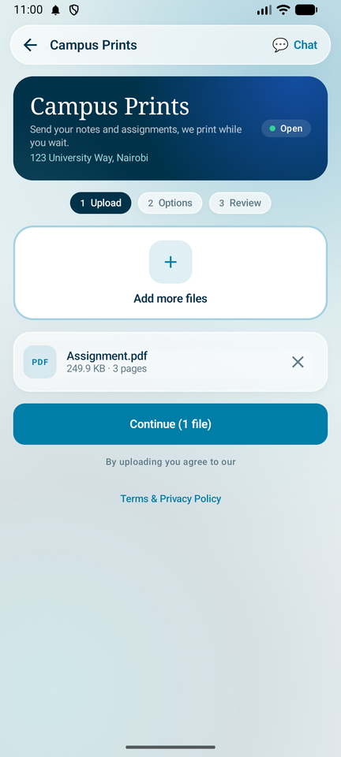
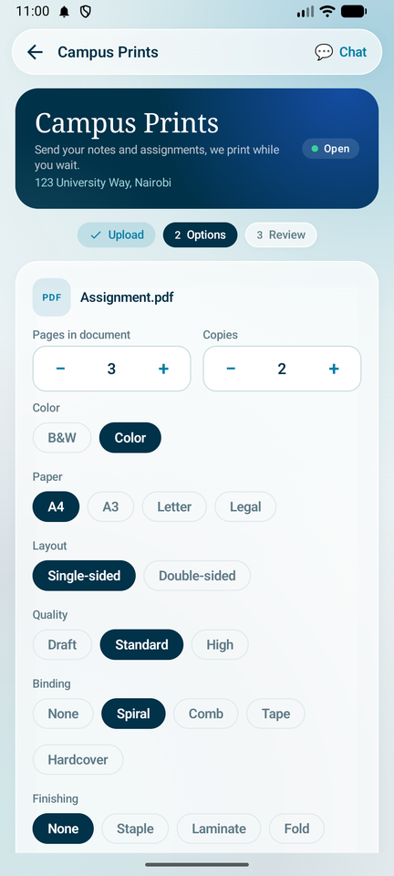
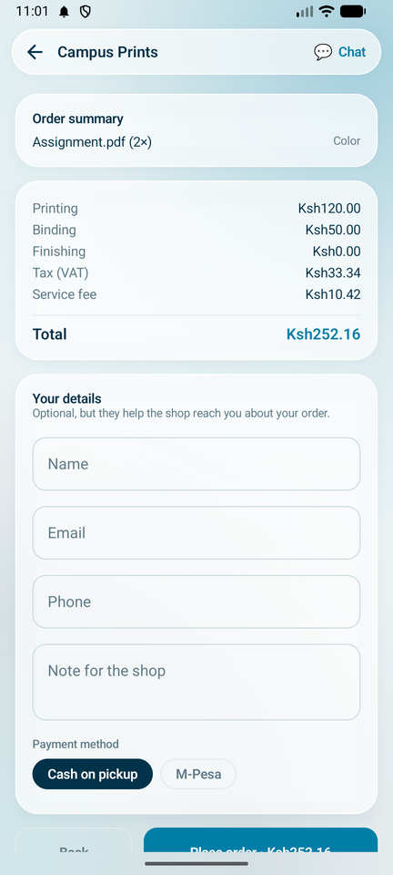
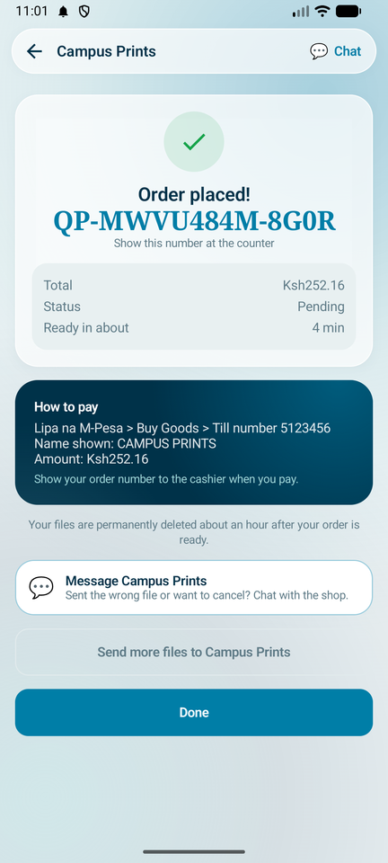
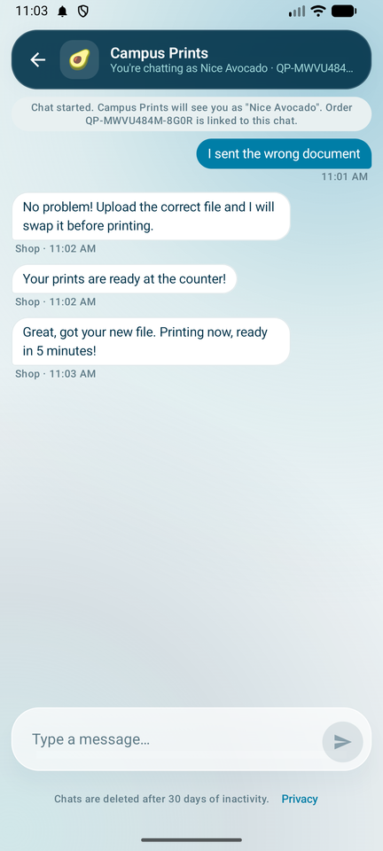
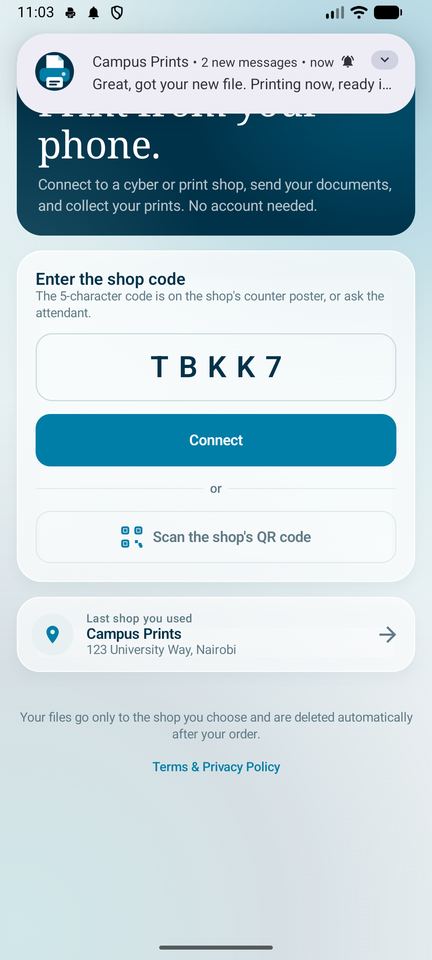

# QuickPrint for Android

> **The customer app for QuickPrint.** Walk into a cyber café or print shop, enter its code or scan its QR poster, send your documents from your phone and collect your prints. Chat with the shop if something changes. No account needed.

<p align="center">
  
</p>

Built with Kotlin and Jetpack Compose. It talks to the same API as the website, so shops see app orders and chats in their normal dashboard.

| Part | Repository | What it is |
|---|---|---|
| **Android app** (this repo) | [Brian-Kareithi/QuickPrint-Android](https://github.com/Brian-Kareithi/QuickPrint-Android) | Customer app |
| Website | [Brian-Kareithi/QuickPrint](https://github.com/Brian-Kareithi/QuickPrint) | Customer portal, shop dashboard (where shops reply to chats), Terms & Privacy |
| API | [Thee-Entity/QuickPrint-Backend](https://github.com/Thee-Entity/QuickPrint-Backend) | NestJS REST + Socket.IO on Railway |

| | |
|---|---|
| App ID | `com.quickprint.app` |
| Min Android | 7.0 (API 24) |
| Target | API 37 |
| UI | Jetpack Compose · Material 3 |
| Backend | `https://quickprint-backend-production.up.railway.app/api` |
| Website / Terms | `https://quickprint-ten.vercel.app` · [/terms](https://quickprint-ten.vercel.app/terms) |

## Screenshots

| Connect to a shop | Upload | Print options | Review & pay |
|:---:|:---:|:---:|:---:|
|  |  |  |  |

| Order placed | Chat with the shop | Reply notification |
|:---:|:---:|:---:|
|  |  |  |

## How it works

1. **Connect.** Type the shop's 5-character code, scan its QR poster, or tap a shop link (`https://quickprint-ten.vercel.app/shop/<slug>`), which opens straight in the app. The last shop you used is one tap away.
2. **Upload.** Pick one or more documents. Only the file types that shop accepts are offered, files stream up with a progress bar, and PDF page counts are detected automatically.
3. **Choose options** per file: pages, copies, colour, paper size, single/double-sided, quality, binding and finishing.
4. **Review & order.** The price breakdown comes from the shop's own pricing on the server. Add an optional name, email, phone and note, choose cash, M-Pesa or Airtel, and place the order.
5. **Pay & collect.** You get an order number and the shop's exact payment steps (Till, Paybill or Send Money). Show the number at the counter.
6. **Chat if anything changes.** Wrong file, or want to cancel? Tap **Chat** (or *Message the shop* after ordering). You're given a fun nickname such as *Golden Melon 🍈*, the shop sees your order next to the chat, and replies reach you as notifications.

## Features

- **Connect your way:** code, QR or link. QR scanning uses Google's code scanner, so the app never asks for camera permission.
- **Chat with the shop:** one-tap messages ("I want to cancel my order", "I sent the wrong document"…), fruit nicknames instead of your name, orders linked automatically, and chats that resume where you left off.
- **Reply notifications:** a heads-up notification **pops up only when the shop actually replies**; nothing is shown while waiting. With the app open (any screen) replies are checked every 10 seconds. With the app closed, it checks about every minute for 2 hours after you message a shop, then every 15 minutes (Android may stretch this while the phone is idle). Tapping the notification opens that chat. Notification permission is asked once, after your first chat message, with an explanation.
- **Liquid-glass design:** translucent frosted cards, step pills and floating rounded glass bars (chat top bar and message bar, shop top bar) over a soft, slowly drifting brand-colour backdrop in light mode.
- **Motion:** gentle screen transitions, step changes that slide, staggered fade-ins, press feedback on cards, a success tick that springs in, and animated error messages.
- **Loading skeletons** shaped like the real screens: a soft shimmer in light mode, a flat pulse in dark mode.
- **Light & dark:** follows the phone's setting. Same palette as the website (`#003249`, `#007ea7`, `#9ad1d4`); dark mode is flat navy-charcoal with no gradients.
- **Responsive:** content keeps a comfortable width on tablets and in landscape.
- **Privacy first:** links to the [Terms & Privacy Policy](https://quickprint-ten.vercel.app/terms). The server deletes files soon after the order is done and chats after 30 days of inactivity. Your private chat key is excluded from cloud backup and device transfer.

## Getting started

1. Open the project in **Android Studio** (it uses its bundled JDK).
2. Let Gradle sync (**File → Sync Project with Gradle Files**), then run the `app` configuration on a device or emulator.

From the command line (Windows, using Android Studio's JDK):

```sh
set JAVA_HOME=C:\Program Files\Android\Android Studio\jbr
gradlew assembleDebug
gradlew testDebugUnitTest
```

The APK is written to `app/build/outputs/apk/debug/app-debug.apk`.

## Configuration

The backend and website URLs are build-time constants (`BuildConfig.API_BASE_URL`, `BuildConfig.WEB_BASE_URL`) set in [`app/build.gradle.kts`](app/build.gradle.kts). They default to production and can be overridden per build:

```sh
# Test against a backend running on your PC
adb reverse tcp:4000 tcp:4000
gradlew assembleDebug -PapiBaseUrl=http://localhost:4000/api -PwebBaseUrl=http://localhost:3000 --no-configuration-cache
```

Debug builds allow plain HTTP only to `localhost` and `10.0.2.2` ([`app/src/debug`](app/src/debug)); release builds are HTTPS only. Use `--no-configuration-cache` when switching URLs so Gradle doesn't reuse the previous values.

> Note: Android 17 limits background access to `localhost`, so background reply checks only work against a real (HTTPS) backend. Use production or a tunnel to test notifications with the app closed.

## Project structure

```
app/src/main/java/com/quickprint/app/
├── MainActivity.kt          Entry point: shop links, notification taps, 10-second reply checks while open
├── QuickPrintApp.kt         Navigation (home → shop → chat) with slide/fade transitions, max content width
├── data/                    API client (OkHttp), models, shop/order/chat repositories, on-device prefs
├── notifications/
│   ├── ChatChecker.kt       Checks every chat for new shop replies and shows the notification
│   ├── ChatCheckWorker.kt   WorkManager: ~1-minute checks after messaging, then every 15 minutes
│   ├── ChatNotifications.kt Notification channel, heads-up notification, "chat on screen" tracking
│   └── NotificationPermissionPrompt.kt
└── ui/
    ├── home/                Shop code entry + QR scanning + last shop
    ├── shop/                Upload → options → review → order placed (OrderViewModel)
    ├── chat/                Guest chat with fruit nicknames (ChatViewModel), floating glass bars
    ├── components/          Brand panel, glass modifier, cards, skeletons, motion helpers, terms link, QR glyph
    └── theme/               QuickPrint colours (light + flat dark), type, shapes
```

## Permissions

| Permission | Why |
|---|---|
| `INTERNET` | Talk to the QuickPrint API |
| `POST_NOTIFICATIONS` | Show the shop's replies (asked once, after your first chat message, with an explanation) |

No camera permission is needed: QR scanning uses Google's code scanner.

> **Instant push at any time** with the app closed would need Firebase Cloud Messaging. The current approach needs no Firebase project and never shows a notification unless there is a new message.

## Troubleshooting

| Problem | Fix |
|---|---|
| "No shop found with that code" | Check the 5 characters on the shop's poster. Codes can be regenerated by the shop owner. |
| "File type not allowed" | The shop doesn't accept that type. Ask them to enable it in Dashboard → Settings. |
| No reply notifications | Allow notifications for QuickPrint in Android settings. Battery saver can delay background checks; open the app to check immediately. |
| QR scanner doesn't open | Update Google Play services, or enter the shop code instead. |

## Publishing to Google Play

- The app ID is `com.quickprint.app`. **It can never change once published.**
- Create a signing key and a release build (`gradlew bundleRelease`).
- The 512 px store icon is at [`app/src/main/ic_launcher-playstore.png`](app/src/main/ic_launcher-playstore.png); adaptive and themed (monochrome) launcher icons are included.
- Declare notification use in the Play Console data-safety form (no data is shared with third parties).
- To have shop links open the app without the "Open with" prompt, add `android:autoVerify="true"` to the link intent filter and host an `assetlinks.json` on the website.
